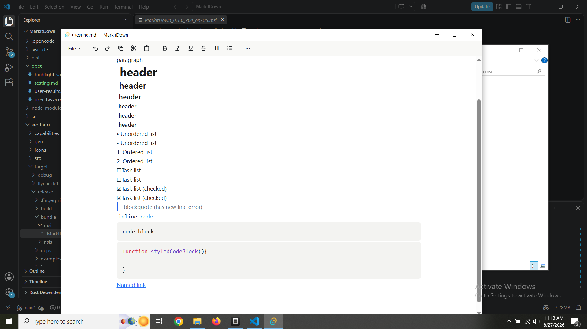

**bold**
*italic*
__underline__
~~strikethrough~~
***__~~all~~__***
paragraph
# header
## header
### header
#### header
##### header
###### header
# header with id {#custom-id}
-# Subtext
- Unordered list
- Unordered list
  - Indented unordered list
  - Indented unordered list
- Unordered list
- Unordered list

1. Ordered list
2. Ordered list
  3. Indented ordered list
  4. Indented ordered list
    5. Indented ordered list
    6. Indented ordered list
7. Ordered list
8. Ordered list

-[] Task list
-[] Task list
-[x] Task list (checked)
-[x] Task list (checked)
> blockquote
`inline code`
```
code block
```
```javascript
function styledCodeBlock(){

}
```
[Named link](www.example.com)

^Image

| Col 1 | Col 2 | Col 3 |
| ----- | ----- | ----- |
| Table |  |  ==bob==|
|  |  bob|  |
|  :D|  |  `code`|


---
^Horizontal line

[^1] footnote

😃 <- from emoji picker

Definition list
: Definition 1
: Definition 2

~subscript~text

^superscript^text

==highlight== 

|| Spoiler ||

>>>
Inner dropdown text.

==highlight==

| Col 1 | Col 2 | Col 3 |
| ----- | ----- | ----- |
| table |  |  |
|  | :D |  |
|  |  | ^_^ |

>>>

>>> Named Dropdown
Inner named dropdown text.
>>>


## Graph samples (manual QA fixture)
Pie with a title:
%% pie "Fruit share" (Apples, 30) (Bananas, 45) (Cherries, 25) (Oranges, 15) (Kiwis, 20) ("Dragon fruit", 25) %%


Bar with quoted labels (space, comma, parens) + min/max:
%% bar "Sales 2024" Units min 0 max 500 ("New York", 120) ("San Francisco, CA", 200) ("Austin, TX", 90) %%

Line with title + axis labels (two series; pairs take auto x slots 1, 2, …):
%% line "Profits per weekday per site" (Weekday, Monday, Tuesday, Wednesday, Thursday, Friday, Saturday, Sunday) (Income, 0, 1000) (SiteA, 50, 120, 60, 60,800,60,700) (SiteB, 120, 60, 60, 800, 60, 700, 450) %%


Error example (unknown type renders a source-preserving error block):
%% scatter (A, 1) (B, 2) %%

Code-fence counter-example (stays literal text, never a chart):
```md
%% bar (Jan, 120) (Feb, 200) %%
```

Title-less line (axis-only X auto-labels slots 1..N, bare Y auto-scales):
%% line (Weekday) (Hits) (SiteA, 50, 120) %%

Line with lone-max Y (the single Y bound is the max):
%% line "Capped" (X, A, B) (Y, 100) (S, 10, 20) %%


[^1]: Footnote